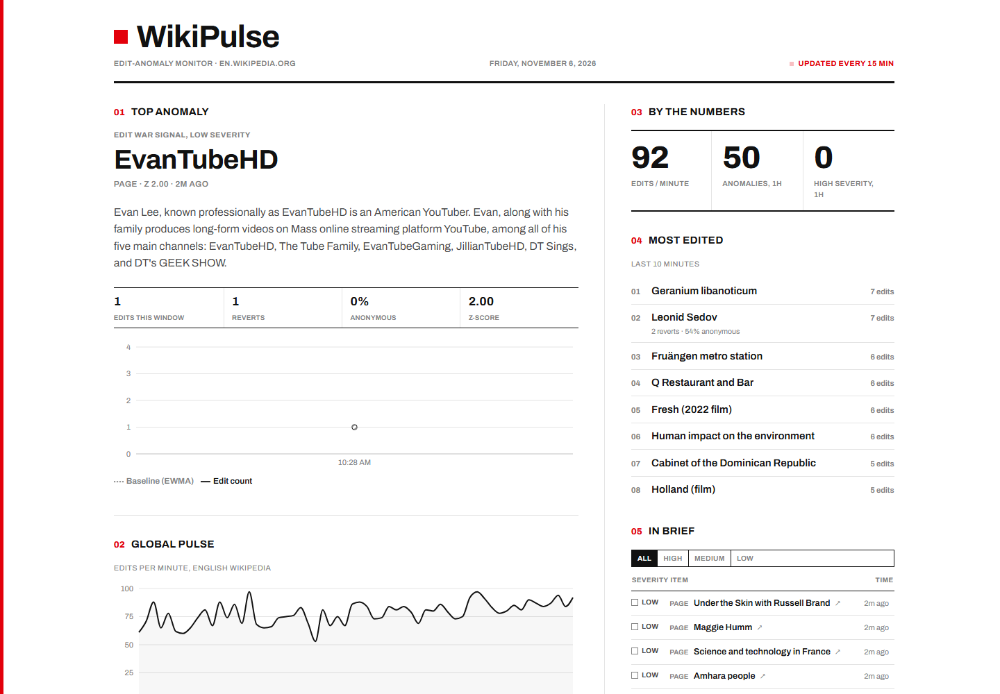

# WikiPulse

**Live demo:** https://wikipulse-six.vercel.app

An anomaly detector for English Wikipedia. It watches every article edit, groups them into one-minute windows per page and per editor, compares each window against that page's or editor's own history, and flags whatever breaks from its normal pattern: an edit rate spiking far past baseline, a burst of edits from logged-out accounts, or a page where most of the edits are reverts (usually an edit war). It also ships an MCP server, so an AI agent like Claude can investigate a flag on its own, pull up the actual edits behind it, and say whether it looks like vandalism, breaking news, or a bot.

This repo is a showcase only: architecture, numbers, and methodology, with no source code. The implementation lives in a private repo.

## Why I built it

I wanted real experience with streaming data and distributed processing, not another notebook that only ever ran once on a CSV I downloaded. Trust and safety teams at companies like Meta or Reddit run abuse-detection pipelines on live platform activity, and I wanted to build a small, one-person version of that against data that is genuinely live. Wikipedia was a good fit because every edit is public and arrives in real time, and because "unusual" depends heavily on context. Ten edits in a minute is normal for a page about breaking news but alarming for an obscure article, so a single global threshold would either miss most problems or flag everything. That is the main reason every page and editor gets its own baseline.

## Architecture

I built WikiPulse first as a real-time streaming system, then redesigned the production deployment to run for free. Both versions use the same detection logic.

**Streaming version** (how it was built, and still runs locally with Docker Compose):

```
Wikipedia EventStreams (server-sent events)
        |
Python producer  -->  Redpanda (Kafka API)
        |
Spark Structured Streaming
   1-minute tumbling windows, 2-minute watermark for late events
   EWMA baseline + z-score per page and per editor
        |
TimescaleDB  -->  FastAPI  -->  React dashboard
```

**Production version** (what powers the live demo, $0/month):

```
Supabase pg_cron, every 15 minutes
        |  POST (shared-secret auth)
FastAPI on Vercel  -->  batch job pulls every edit since the last run
        |               from Wikipedia's recentchanges API
        |               same windows, same EWMA + z-score logic
Supabase Postgres
        |
        +-->  REST API  -->  React dashboard (Vercel)
        +-->  MCP server (/mcp)  -->  Claude or any MCP client
```

The streaming version needed Redpanda and Spark running around the clock, which was more than I could justify paying for a portfolio project. A batch job every 15 minutes gives up a little freshness (flags show up within about 15 minutes instead of 1 or 2), but costs nothing, and since detection is the same either way, the results are directly comparable.

## By the numbers

Measured from the production database in November 2026:

| | |
|---|---|
| Edit volume | about 100 English Wikipedia article edits per minute |
| Each batch run | about 1,600 edits processed in 1 to 2 seconds |
| Data kept | 2 days of windows: about 180,000 rows covering about 72,000 pages and 17,000 editors |
| Database size | under 200 MB, inside Supabase's free 500 MB |
| Logged-out editors | about 11% of edits |
| Hosting cost | $0/month (Supabase, Vercel, all on free tiers) |

## How the detection works

Nothing fancy, just statistics. For every page and every editor, in every one-minute window:

1. **Baseline.** Keep an exponentially weighted moving average (EWMA, smoothing factor 0.3) of edits per minute, along with an EWMA of the variance.
2. **Score.** Compute a z-score: how many standard deviations this minute is from that entity's own baseline. The standard deviation is floored at 1.0 so a brand-new page with no history can't produce an absurd score.
3. **Flag.** Anything with |z| above 3 is an anomaly. Severity is low from 3 to 4, medium from 4 to 6, and high above 6.
4. **Edit wars.** Separately, a page is flagged when more than half of its edits in a minute are reverts, because a high revert ratio matters even on a page that is already busy.

I kept the baseline state in a Postgres table that each batch reads and updates, instead of inside Spark's own state store. Spark's native stateful operators would be faster, but I wanted the state to be something I could query and check by hand while I was still verifying the math.

## MCP server

The backend also exposes a Model Context Protocol server, so an LLM agent can investigate anomalies directly instead of a person clicking through the dashboard.

**Tools** (all read-only):
- `get_active_anomalies`: recent flags, filterable by severity and by page or editor
- `get_entity_timeline`: minute-by-minute activity for one page or editor, with its baseline and z-scores
- `get_trending_pages`: the most-edited pages right now
- `get_anomaly_context`: one flag with its surrounding history, related flags, and the actual Wikipedia edits from that window (editor, edit summary, bytes changed), pulled live from Wikipedia's API since the database only stores per-minute counts
- `get_pipeline_health`: how fresh the data is, so the agent can tell "Wikipedia is quiet" apart from "the pipeline is down"

**Resources:** the data schema, and a description of the detection method including its known blind spots, so the agent doesn't overstate what a flag means.

**Prompts:** an "investigate this anomaly" triage workflow, and a short "what's happening right now" briefing.

It uses the Streamable HTTP transport in stateless mode, so it runs on serverless hosting. Every request needs an API key, there is a per-client rate limit, and no tool can write anything.

## Tech stack

- **Streaming:** Python, PySpark, Spark Structured Streaming, Redpanda (Kafka API), TimescaleDB, Docker Compose
- **Production:** FastAPI, PostgreSQL (Supabase), pg_cron + pg_net, Vercel
- **AI integration:** MCP Python SDK (Streamable HTTP)
- **Frontend:** React, TypeScript, Vite
- **Data:** Wikipedia EventStreams (streaming version), MediaWiki recentchanges API (batch version)

## Screenshots



(a short GIF of Claude using the MCP server goes here)

## Notes on methodology

A few things I ran into while building and running this, because most of what I learned came from them:

- **Fitting Spark into 1 GB.** The streaming job originally ran in a 1 GB container, and it kept getting killed a few minutes after starting. The cause turned out to be off-heap Netty buffers in Spark's Kafka connector slowly growing until the container ran out of memory. Capping direct memory at 64 MB fixed it, along with a 512 MB driver heap, a 256 MB metaspace limit (any lower and Spark's own class loading failed), and the serial garbage collector, since G1's overhead isn't worth it at heaps this small.
- **The data changed underneath me.** Wikipedia started giving logged-out editors temporary accounts (names like `~2026-53667-39`) instead of showing their IP address. My anonymous-editor detection matched IP addresses, so it quietly dropped to nearly zero without any error. I only caught it by checking the live data by hand. It now counts temporary accounts, and anonymous edits came back to about 11%.
- **Missing the most common revert.** My revert detection looked for "revert" or "undo" in the edit summary, but Wikipedia's standard undo summary is "Undid revision...", which matches neither. A unit test caught it, and the fix went into both the streaming and batch versions.
- **Schedulers aren't always on time.** The batch job first ran on a GitHub Actions schedule set to every 15 minutes, but in practice runs were landing 5 to 8 hours apart, since GitHub deprioritizes scheduled jobs. I moved the trigger into the database itself with pg_cron, which fires on time.
- **Known limitation: noisy revert flags.** About 94% of all flags are low-severity revert-rate flags, mostly a single revert on a quiet page, which technically counts as "100% reverts." The edit-rate flags are much more selective. Requiring a minimum number of edits before the revert rule applies is the obvious next fix. I also don't have labeled ground truth for what counts as real abuse, so I am not claiming a precision number; I evaluate flags by reading the actual edits behind them.
